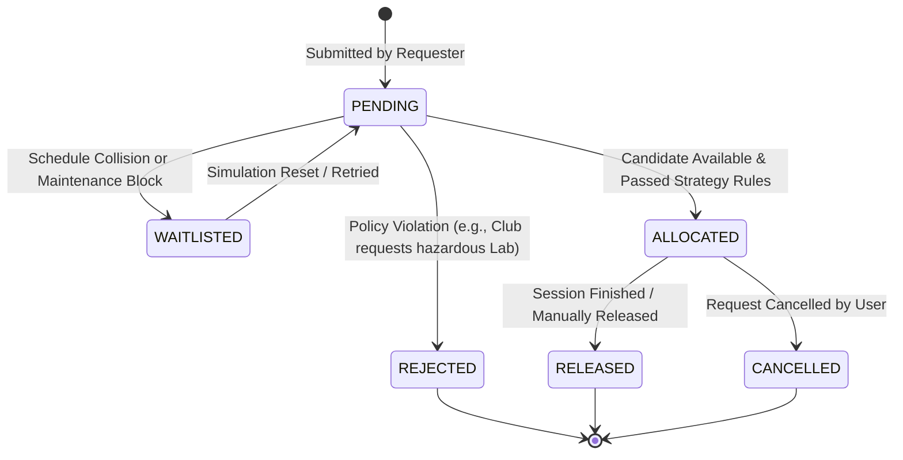
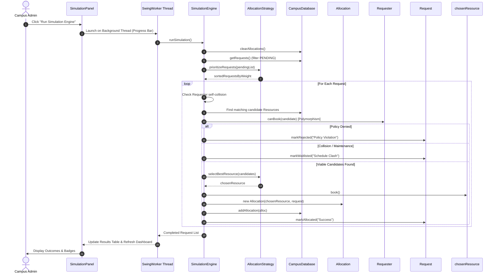

# Architecture & Design Blueprint

> **Campus Resource Allocation Simulator**
> *Structured MVC-inspired Architecture designed for College Evaluation & Academic Transparency.*

---

## 1. Architectural Layers & Boundaries

```
+---------------------------------------------------------------------------------------+
|                                    PRESENTATION LAYER                                 |
|                                     (com.campus.gui)                                  |
|                                                                                       |
|   +-------------------------------------------------------------------------------+   |
|   |             MainFrame (Window Shell with Left Navigation Sidebar)             |   |
|   +-------------------------------------------------------------------------------+   |
|         |                 |                |                 |               |        |
|         v                 v                v                 v               v        |
|   +-----------+     +------------+   +------------+   +------------+   +------------+ |
|   | Dashboard |     |  Resource  |   | Requester  |   |  Request   |   | Simulation | |
|   |   Panel   |     |   Panel    |   |   Panel    |   |   Queue    |   |   Engine   | |
|   +-----------+     +------------+   +------------+   +------------+   +------------+ |
|         |                 |                |                 |               |        |
|         +-----------------+----------------+-----------------+---------------+        |
|                                           |                                           |
|                                           v                                           |
|                   +-----------------------------------------------+                   |
|                   |  UITheme (Blue & Off-White Palette + Inter)   |                   |
|                   +-----------------------------------------------+                   |
+-------------------------------------------|-------------------------------------------+
                                            | (Invokes Service Layer & Simulation Engine)
                                            v
+---------------------------------------------------------------------------------------+
|                                    SERVICE LAYER                                      |
|                                  (com.campus.service)                                 |
|                                                                                       |
|   +------------------------+      +---------------------+      +------------------+   |
|   |    CampusDatabase      |      |  SimulationEngine   |      | FileReportService|   |
|   |  (Singleton In-Memory) |<---->| (Collision & Safety)|<---->|  (File I/O disk) |   |
|   +------------------------+      +---------------------+      +------------------+   |
+---------------------------------------------|-----------------------------------------+
                                              | (Selects Strategy via Interface)
                                              v
+---------------------------------------------------------------------------------------+
|                                    STRATEGY LAYER                                     |
|                                 (com.campus.strategy)                                 |
|                                                                                       |
|                         +-----------------------------------+                         |
|                         |      <<AllocationStrategy>>       |                         |
|                         +-----------------------------------+                         |
|                                   ^               ^                                   |
|                +------------------+       +-------+-------+                           |
|                |                          |               |                           |
|      +------------------+      +------------------+  +--------------------+           |
|      | PriorityStrategy |      | FairnessStrategy |  |  CapacityStrategy  |           |
|      +------------------+      +------------------+  +--------------------+           |
+---------------------------------------------|-----------------------------------------+
                                              | (Operates on Pure Domain Models)
                                              v
+---------------------------------------------------------------------------------------+
|                                     DOMAIN LAYER                                      |
|                                  (com.campus.model)                                   |
|                                                                                       |
|   +--------------------+       +---------------------+       +--------------------+   |
|   |      Resource      |       |      Requester      |       |  AllocationRequest |   |
|   |     (Abstract)     |       |     (Abstract)      |       |    (Composite)     |   |
|   +--------------------+       +---------------------+       +--------------------+   |
|      ^    ^    ^    ^             ^     ^          ^                      |           |
|      |    |    |    |             |     |          |                      v           |
|   [Classroom] [Lab] |   [Department] [Faculty] [Club]            +----------------+   |
|        [Auditorium] |                                            |   Allocation   |   |
|         [Equipment] |                                            |  (Reservation) |   |
|                     v                                            +----------------+   |
|          +--------------------+                                                       |
|          |    <<Bookable>>    |                                                       |
|          +--------------------+                                                       |
+---------------------------------------------------------------------------------------+
```

---

## 2. Allocation Life-Cycle State Machine

A submitted `AllocationRequest` progresses through well-defined lifecycle states:



---

## 3. Class Interactions: Running an Allocation Simulation



---

## 4. Key Architectural Decisions (ADRs)

1. **Pure Java without Maven / Frameworks**:
   - *Rationale*: For university and college project submissions, build tools like Maven or Gradle often fail on evaluators' computers due to proxy issues, missing internet access, or outdated local repository configurations. Building with standard `javac` and providing one-click `.bat` and `.sh` scripts guarantees 100% portability.
2. **Layered Separation of Concerns**:
   - *Rationale*: The `com.campus.model` layer contains zero Swing imports. This enables adding a console interface or file database in the future without altering business entities.
3. **Strategy Pattern for Algorithms**:
   - *Rationale*: Separates business rules (`Priority`, `Fairness`, `Capacity`) into distinct interchangeable classes, allowing professors to see clean algorithm comparison during demonstrations.
