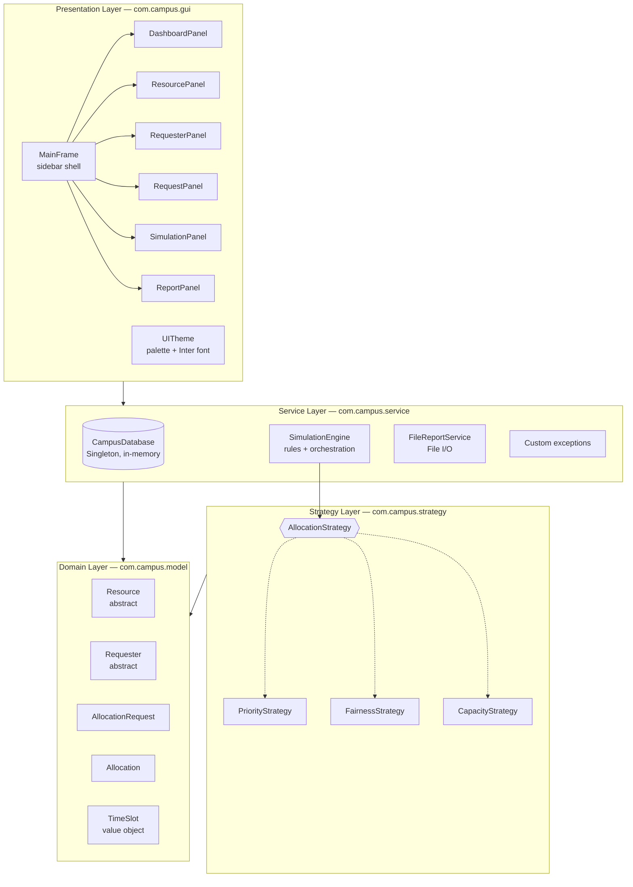
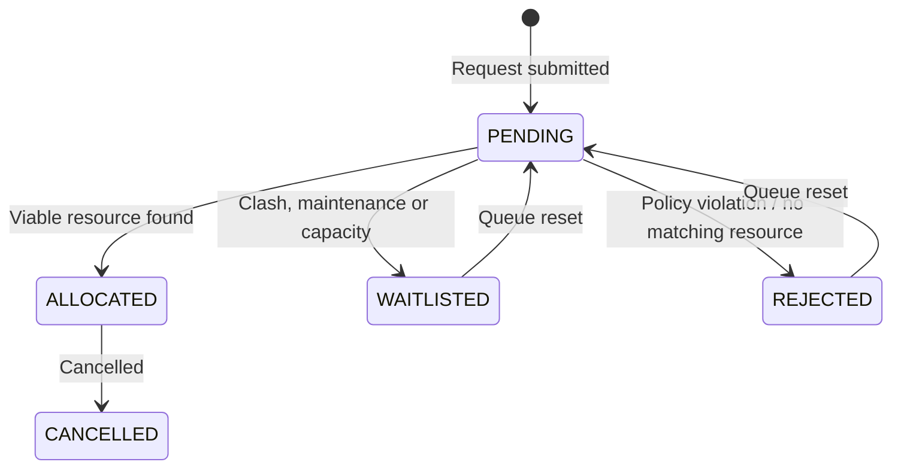

# SlotWise

### Smart Campus Resource Allocation Simulator

> Fair, conflict-free booking of classrooms, labs, auditoriums and equipment with swappable allocation strategies one can compare live.

**SlotWise** is a pure-Java desktop application that simulates how a university decides who gets which room, when. Departments, faculty and student clubs compete for limited facilities; SlotWise detects clashes, enforces safety policy, and lets an administrator switch between allocation algorithms at runtime to see how each one changes fairness and utilization.

---

## Table of Contents

1. [Features](#1-features)
2. [Quick Start](#2-quick-start)
3. [Architecture](#3-architecture)
4. [How an Allocation Works](#4-how-an-allocation-works)
5. [Allocation Strategies](#5-allocation-strategies)
6. [Domain Model](#6-domain-model)
7. [Design Patterns & OOP Concepts](#7-design-patterns--oop-concepts)
8. [Project Structure](#8-project-structure)
9. [Testing](#9-testing)
10. [Design Decisions](#10-design-decisions)
11. [Future Work](#11-future-work)

---

## 1. Features

| Screen | What it does |
|---|---|
| **Dashboard** | Live metrics: total resources, requesters, requests, allocations, waitlist size, utilization %. Table of confirmed bookings. |
| **Resource Catalog** | Browse/filter/search classrooms, labs, auditoriums, equipment. Toggle maintenance mode. Add resources via a factory. |
| **Requester Directory** | Departments, faculty and student clubs with priority tiers and current load. Register new requesters. |
| **Request Queue** | Submit reservation requests (date, hours, capacity, urgency, purpose). Reset the queue to re-run scenarios. |
| **Simulation Lab** | Pick a strategy, run the engine on a background thread, and read a per-request log explaining every outcome. |
| **Audit & Reports** | Summary stats and an exportable text audit (`reports/simulation_audit_report.txt`). |

**Rules enforced by the engine**
- No double-booking of a resource in overlapping time slots
- No requester holding two bookings in the same slot
- Maintenance blocks and seat-capacity checks
- Safety policy (e.g. student clubs cannot book hazardous labs)

---

## 2. Quick Start

**Requirements:** JDK 17 or newer.

| | Windows | Linux / macOS |
|---|---|---|
| Compile | `compile.bat` | `./compile.sh` |
| Run the GUI | `run.bat` | `./run.sh` |
| Run tests | `test.bat` | `./test.sh` |

On Linux/macOS, run `chmod +x *.sh` once first.

**Manual build (any OS):**

```bash
javac -encoding UTF-8 -d bin -sourcepath src src/com/campus/Main.java src/com/campus/VerificationTest.java
java -cp bin com.campus.Main              # launch the app
java -cp bin com.campus.VerificationTest  # run the test suite
```

---

## 3. Architecture

SlotWise uses a four-layer architecture. Dependencies point **downward only**, and the domain layer has zero Swing imports.



## 4. How an Allocation Works

### Request lifecycle



### Decision rules (in order)

1. **Requester self-clash** → waitlist
2. **No resource of the requested type exists** → reject
3. **Requester lacks clearance for every candidate** (polymorphic `canBook`) → reject
4. **Per-candidate filter**: under maintenance, too small, no clearance, or already booked in that slot
5. **No candidates left** → waitlist, with every reason recorded
6. **Otherwise** → strategy picks the winner; booking is created

---

## 5. Allocation Strategies

All strategies implement `AllocationStrategy` (`prioritizeRequests`, `selectBestResource`, `getName`, `getDescription`). The engine swaps them with `engine.setStrategy(...)`.

| Strategy | Ordering | Resource choice |
|---|---|---|
| **Priority-First** | Combined score, highest first. Base score: Department 60, Faculty 45, Club 25, plus urgency × 10. | First viable resource |
| **Fairness-Aware** | `score / (1 + 1.5 × allocationsAlreadyHeld)` — heavy users are progressively down-weighted | First viable resource |
| **Capacity-Optimized** | Best-fit ordering | Smallest room that still fits (minimizes empty seats) |

---

## 6. OOP principles

| Principle | Example |
|---|---|
| **Encapsulation** | `TimeSlot` is immutable and validates `end > start`; capacity validated in constructors |
| **Abstraction** | `Bookable`, abstract `Resource` and `Requester` |
| **Inheritance** | 4 resource subclasses, 3 requester subclasses |
| **Polymorphism** | `calculateOperatingCostPerHour()` differs per resource; `StudentClub.canBook()` blocks hazardous labs while `Department.canBook()` allows them |
| **Composition** | `AllocationRequest` has-a `Requester` + `TimeSlot`; `Allocation` has-a `Resource` + `AllocationRequest` |

### Java features used

Collections (`List`, `unmodifiableList`), Streams & lambdas, custom exceptions (`ResourceUnavailableException`, `InvalidBookingException`), `SwingWorker` multithreading, File I/O with try-with-resources, `equals`/`hashCode` on value objects.

---

## 8. Project Structure

```
slotwise/
├── compile.bat / compile.sh     # Build scripts
├── run.bat / run.sh             # Launch GUI
├── test.bat / test.sh           # Run verification suite
├── resources/Inter.ttf          # Bundled font
├── reports/                     # Exported audit files
└── src/com/campus/
    ├── Main.java                # Entry point
    ├── VerificationTest.java    # Automated test suite
    ├── model/                   # Domain: Resource, Requester, TimeSlot, Allocation, enums, ResourceFactory
    ├── strategy/                # AllocationStrategy + Priority / Fairness / Capacity
    ├── service/                 # CampusDatabase, SimulationEngine, FileReportService, exceptions
    └── gui/                     # MainFrame, UITheme, and the six panels
```
## 11. Future Work

- Persistent storage (file or SQLite) instead of in-memory seed data
- Recurring bookings and calendar view
- Waitlist auto-promotion when a booking is cancelled
- Console / REST front end on top of the existing service layer
- JUnit migration for the verification suite

---

*Built as an object-oriented software engineering project for OOP CWS.*
